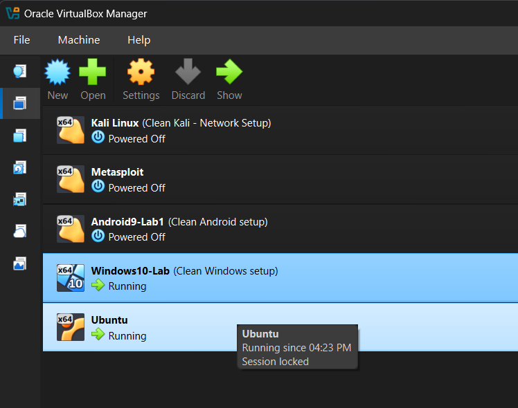
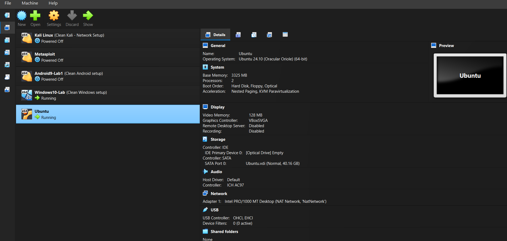
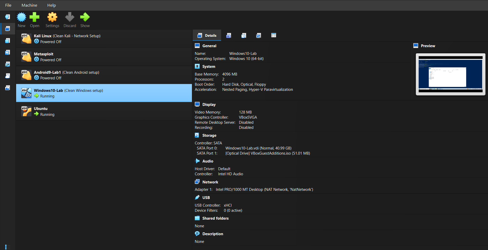
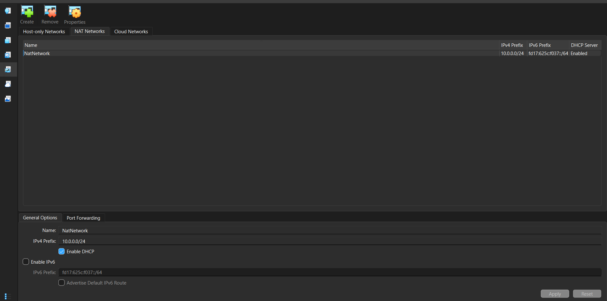
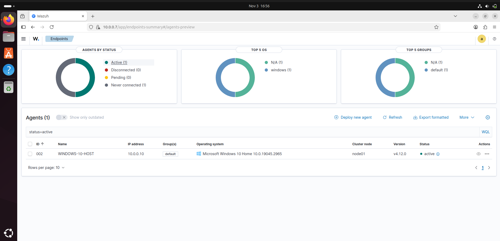

# Lab Architecture – Wazuh SOC Home Lab

## 1. Introduction

This document describes the architecture and virtualized environment used to build the Wazuh SOC Home Lab.

The lab is designed to understand Security Information and Event Management (SIEM), endpoint monitoring, security event collection, and File Integrity Monitoring (FIM).

The environment consists of an Ubuntu virtual machine running the Wazuh monitoring infrastructure and a Windows 10 virtual machine configured as a monitored endpoint.

Both virtual machines operate within a VirtualBox NAT Network to enable communication between the Wazuh manager and the Windows agent.

## 2. Lab Architecture

The lab follows a centralized monitoring architecture in which the Wazuh manager collects and analyzes security information generated by the monitored Windows endpoint.

### Architecture Diagram

```text
                  Windows 11 Host
                         |
                  Oracle VirtualBox
                         |
                     NAT Network
                         |
              +----------+----------+
              |                     |
         Ubuntu 24.04           Windows 10
            VM                     VM
              |                     |
       Wazuh Manager           Wazuh Agent
       Wazuh Indexer           Endpoint Monitoring
       Wazuh Dashboard         Event Collection
              |                     |
              |<--------------------|
              |
       Centralized Monitoring
              |
       Security Alerts
       File Integrity Events
       Event Analysis
```

### Virtual Machine Overview

The lab contains two virtual machines managed through Oracle VirtualBox: an Ubuntu VM hosting Wazuh and a Windows 10 VM acting as the monitored endpoint.



*Figure 1: VirtualBox Manager showing the virtual machines used in the lab.*

### Architecture Components

| Component | Description |
|---|---|
| Windows 11 Host | Physical system used to run the virtual machines. |
| Oracle VirtualBox | Hypervisor used to create and manage the virtual machines. |
| Ubuntu 24.04.4 LTS | Virtual machine hosting the Wazuh monitoring infrastructure. |
| Wazuh Manager | Receives and analyzes security events collected from the endpoint. |
| Wazuh Indexer | Stores and indexes security event data. |
| Wazuh Dashboard | Provides a graphical interface to view monitoring information and alerts. |
| Windows 10 Home 22H2 | Monitored endpoint running the Wazuh agent. |
| Wazuh Agent | Collects endpoint information and forwards relevant events to the manager. |
| NAT Network | Enables network communication between the virtual machines. |

## 3. Lab Environment Specifications

The following table summarizes the hardware and software configuration used in the lab.

| Parameter | Configuration |
|---|---|
| Host Operating System | Windows 11 |
| Hypervisor | Oracle VirtualBox 7.2.12 |
| Wazuh Manager Operating System | Ubuntu 24.04.4 LTS |
| Wazuh Version | 4.12.0 RC1 *(verify against the installed version)* |
| Monitored Endpoint | Windows 10 Home 22H2 |
| Windows Build | 19045.2965 |
| Virtualization Network | NAT Network |
| Network Address Range | `10.0.0.0/24` |

### Ubuntu Virtual Machine Configuration

The Ubuntu virtual machine hosts the Wazuh monitoring components. The screenshot below should show its VirtualBox resource and network configuration.



*Figure 2: Ubuntu VM settings, including memory, processor allocation, and network adapter.*

### Windows 10 Virtual Machine Configuration

The Windows 10 virtual machine acts as the monitored endpoint and runs the Wazuh agent.



*Figure 3: Windows 10 VM settings, including memory, processor allocation, and network adapter.*

## 4. Network Architecture

The virtual machines are connected through a VirtualBox NAT Network.

This configuration allows the Ubuntu Wazuh manager and Windows endpoint to communicate over the virtual network.

The Wazuh agent uses the manager's network address to establish communication and forward collected endpoint information.

The network configuration is intended to provide connectivity between the virtual machines while keeping the lab environment separate from the physical host's normal network configuration.

### NAT Network Configuration

The screenshot below should show the NAT Network name, IPv4 network range, and DHCP setting, if enabled.



*Figure 4: VirtualBox NAT Network configuration used by the lab virtual machines.*

### Network Communication

The communication process follows these stages:

1. The Windows endpoint runs the Wazuh agent.
2. The agent collects relevant endpoint information and security events.
3. The agent communicates with the Wazuh manager over the configured virtual network.
4. The Wazuh manager processes incoming events.
5. The Wazuh indexer stores the collected information.
6. The Wazuh dashboard displays the available monitoring information and alerts.

## 5. Roles of Virtual Machines

### 5.1 Ubuntu Virtual Machine – Wazuh Manager

Ubuntu 24.04.4 LTS is used as the central monitoring system.

The Wazuh infrastructure runs on this virtual machine and provides the following capabilities:

- Receiving security information from connected agents.
- Processing endpoint events.
- Generating security alerts based on configured rules.
- Storing and indexing collected event information.
- Providing access to the Wazuh dashboard.

### 5.2 Windows 10 Virtual Machine – Monitored Endpoint

Windows 10 Home 22H2 is configured as the monitored endpoint.

The Wazuh agent installed on this machine collects relevant endpoint information and communicates with the Wazuh manager.

The endpoint is used to perform practical monitoring activities, including:

- Windows security event collection.
- System activity monitoring.
- File creation and modification monitoring.
- File deletion detection.
- Verification of File Integrity Monitoring alerts.

## 6. Wazuh Dashboard

The Wazuh dashboard provides the interface for viewing information collected from monitored endpoints. Use the screenshot below to demonstrate dashboard access and the status of the Windows agent.



*Figure 5: Wazuh dashboard showing the monitoring interface and Windows agent status. Ensure the screenshot does not expose unrelated or sensitive information.*

## 7. File Integrity Monitoring Architecture

File Integrity Monitoring is one of the primary practical activities in this lab.

Wazuh FIM monitors selected files and directories on the Windows endpoint and identifies changes made to them.

The monitoring process follows these stages:

1. A directory is configured for monitoring through the Wazuh agent.
2. The agent monitors the selected directory for file system changes.
3. A test file is created, modified, or deleted.
4. The agent detects the corresponding file system activity.
5. Relevant FIM events are forwarded to the Wazuh manager.
6. The events are processed and made available through the Wazuh dashboard.
7. The results are reviewed to verify whether the expected changes were detected.

The practical FIM testing procedure and screenshots are documented separately in:

`docs/file-integrity-monitoring.md`

## 8. Monitoring Workflow

The overall monitoring workflow can be summarized as follows:

**Windows Endpoint → Wazuh Agent → Wazuh Manager → Wazuh Indexer → Wazuh Dashboard**

The workflow enables centralized collection and analysis of endpoint security information. It also provides visibility into file system changes and other monitored activities.

## 9. Conclusion

The Wazuh SOC Home Lab provides a virtualized environment for learning SIEM operations and endpoint security monitoring.

By connecting a Windows endpoint to an Ubuntu-based Wazuh monitoring infrastructure, the lab demonstrates how endpoint information can be collected, processed, and visualized centrally.

The environment also provides a foundation for practical File Integrity Monitoring experiments and further development of defensive security monitoring capabilities.

